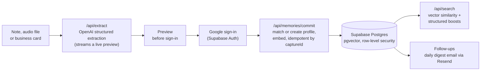

# Orbit (v0, web)

Orbit is a capture-first relationship memory app. You write, or upload, the rough note
you would otherwise keep in your head about someone you met. Orbit extracts a structured
profile from it, saves it to a private database, makes it searchable by meaning, and
reminds you when to follow up.

**Live demo:** https://orbit-six-blond.vercel.app (you can try capture without an
account; saving requires Google sign-in)

## Where this fits

Orbit has gone through three versions. This repository is the first.

| Version | What it is | Where |
|---------|------------|-------|
| **v0** | This web app: Next.js, Supabase (Postgres + pgvector) and OpenAI | [Live demo](https://orbit-six-blond.vercel.app) |
| **v1** | A local-first iOS app | [MaximusAnax/orbit](https://github.com/MaximusAnax/orbit) |
| **v2** | An agent-native memory kept as plain text | Private |

## How it works



1. **Capture before sign-in.** The homepage is the product. You can type a note, upload
   an audio file (transcribed with `whisper-1`) or upload a business card photo (read
   with `gpt-4o-mini`). `/api/extract` turns the text into a structured memory: who the
   person is, how you met, your read on the interaction, tags and a suggested follow-up
   interval. It can stream partial results so the preview fills in progressively.
2. **Save after sign-in.** Pending captures are stored server-side in `pending_captures`
   and in `localStorage`, so a note survives the Google OAuth redirect. Commits are
   idempotent by `captureId`.
3. **Match or create.** A new note is linked to an existing profile on a confident name
   and organization match. On an ambiguous match the user chooses whether to link it or
   create a new profile.
4. **Recall.** Search embeds the query with `text-embedding-3-small`, runs a pgvector
   RPC, adds boosts for matching tags, organization, role and text, and explains why
   each result matched. Results are cached for five minutes, in Upstash Redis if it is
   configured and in process memory otherwise.
5. **Follow up.** From the dashboard or a profile page you can mark someone contacted,
   snooze them, pause follow-ups or set a cadence. A `CRON_SECRET`-protected endpoint
   sends one grouped daily digest email per user through Resend. It respects
   notification preferences and signed unsubscribe links.
6. **Act.** Profile pages can be edited by hand, enriched with conservative metadata
   (provenance is recorded; no external pages are fetched) and used to draft an
   outreach message.

Without `OPENAI_API_KEY` the app still runs. It uses heuristic extraction,
pseudo-embeddings, placeholder transcripts and OCR text, and template outreach drafts.

## Stack

- **Frontend:** Next.js 15 (App Router), React 19, Tailwind CSS 4, Motion
- **Backend:** Next.js route handlers, Supabase Auth (Google OAuth), Supabase Postgres
  with `pgvector` and row-level security on user data
- **AI:** OpenAI `gpt-4o-mini` (extraction, card OCR, outreach drafts), `whisper-1`
  (audio), `text-embedding-3-small` (1536-dimension embeddings), with timeouts and
  retries
- **Email:** Resend REST API
- **Hosting:** Vercel

## Routes

| Route | Purpose |
|-------|---------|
| `/` | Capture and preview (works signed out) |
| `/app` | Dashboard: search, recent captures, overdue and upcoming follow-ups |
| `/profiles/[id]` | Profile, interaction timeline, editing, follow-up and outreach controls |
| `/settings/notifications` | Email digest preferences |
| `/auth/login`, `/auth/callback`, `/auth/error` | Google OAuth through Supabase |

| API | Method | Purpose |
|-----|--------|---------|
| `/api/extract` | POST | Structured extraction (JSON or streamed) |
| `/api/capture/audio` | POST | Audio upload, transcribed |
| `/api/capture/card` | POST | Business card image, read with a vision model |
| `/api/memories/commit` | POST | Save a capture, match or create a profile |
| `/api/search` | POST | Semantic search with ranking explanations |
| `/api/profiles/[id]` | PATCH | Edit a profile |
| `/api/profiles/[id]/follow-up` | POST | Mark contacted, snooze, pause, set cadence |
| `/api/profiles/[id]/enrich` | POST | Conservative enrichment with provenance |
| `/api/profiles/[id]/outreach-draft` | POST | Draft a follow-up message |
| `/api/reminders/daily-digest` | POST | Daily digest job (requires `CRON_SECRET`) |
| `/api/notification-preferences` | GET, PATCH | Read and update email preferences |
| `/api/notifications/unsubscribe` | GET | Signed one-click unsubscribe |
| `/api/recall/features` | GET | Feature flags for unbuilt recall modes |
| `/api/events` | POST | Product telemetry |

## Data model

Defined in forward-only migrations under `supabase/migrations/`:

- `profiles`: one canonical person per user, with organization, role, follow-up interval
  and next follow-up date
- `interactions`: each captured note, with its structured summary, tags, sentiment and a
  `vector(1536)` embedding
- `pending_captures`: captures made before sign-in, claimed after OAuth
- `reminders`: follow-up reminders and their email delivery state (sent, failed, skipped)
- `enrichment_jobs`: provenance for profile enrichment
- `notification_preferences`: digest settings and unsubscribe state
- `events`: product telemetry

## Local development

Requires Node 20.17+ and a Supabase project, either hosted or local through the Supabase
CLI. Google OAuth must be configured in Supabase Auth.

```bash
npm install
cp .env.example .env.local     # then fill in the values below
npx supabase start             # optional: local Supabase
npx supabase db push           # apply migrations
npm run dev
```

| Variable | Needed for |
|----------|-----------|
| `NEXT_PUBLIC_SUPABASE_URL`, `NEXT_PUBLIC_SUPABASE_PUBLISHABLE_KEY` | Required |
| `NEXT_PUBLIC_APP_URL` | Required (OAuth redirects, email links) |
| `OPENAI_API_KEY` | Real extraction, transcription, OCR and embeddings (local fallbacks otherwise) |
| `SUPABASE_SERVICE_ROLE_KEY`, `CRON_SECRET` | Daily digest job |
| `RESEND_API_KEY`, `REMINDER_FROM_EMAIL` | Sending digest emails |
| `UPSTASH_REDIS_REST_URL`, `UPSTASH_REDIS_REST_TOKEN` | Optional shared search cache |
| `FEATURE_GRAPH_RECALL`, `FEATURE_VOICE_SEARCH`, `FEATURE_EXTERNAL_SYNC` | Optional flags (default off) |

## Testing

```bash
npm test             # Vitest: 32 unit tests
npm run lint         # ESLint
npm run build        # production build
npm run test:e2e     # Playwright: landing smoke test; the authenticated staging
                     # smoke test runs only when STAGING_AUTH_STATE is set
```

`npm run staging:check` and `npm run production:check` validate an environment before
launch (see `docs/`).

## Documentation

- [`prd.md`](prd.md): product requirements after the MVP
- [`tdd.md`](tdd.md): technical design
- [`progress.md`](progress.md): what is built, implementation notes and what is left
- [`orbit_overview.md`](orbit_overview.md): product thesis
- [`docs/staging-runbook.md`](docs/staging-runbook.md),
  [`docs/production-launch-orbit-domain.md`](docs/production-launch-orbit-domain.md):
  deployment

## Limitations

- Audio capture is file upload only; there is no in-browser recording.
- Uploaded audio and card images are processed and then discarded, not stored.
- The daily digest endpoint exists, but no cron schedule is configured in this repo.
- Graph recall, voice search and external sync exist only as feature flags; they are not
  implemented.
- There is no rate limiting on extraction, upload, search or outreach endpoints.
- Automated tests are unit-level. End-to-end coverage of the signed-in flows against a
  real Supabase/OpenAI environment is limited to the opt-in staging smoke test.

## License

[MIT](LICENSE)
